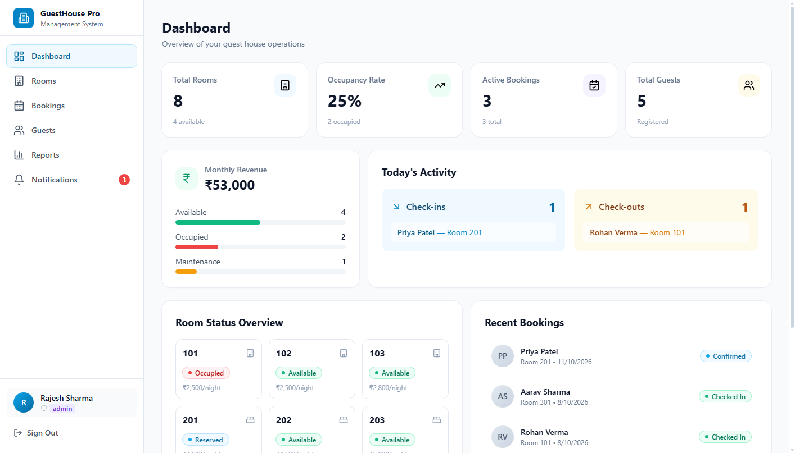

# GuestHouse Pro 🏨

> A modern, full-featured Guest House Management System built with **React 18**, **TypeScript**, **Tailwind CSS**, and **Supabase / Local Offline Engine**. Featuring Indian Rupee (₹ / INR) localization, authentic guest & staff registries, real-time room availability, interactive reservation calendar, and automated reporting.

[](https://mayank-af.github.io/GUESTHOUSE/)
[](https://bolt.new/p/71930407)
[](https://react.dev/)
[](https://www.typescriptlang.org/)
[](https://tailwindcss.com/)
[](LICENSE)

---

## 🌐 Live Application Links

- 🚀 **Live Demo on GitHub Pages**: [https://mayank-af.github.io/GUESTHOUSE/](https://mayank-af.github.io/GUESTHOUSE/)
- ⚡ **Bolt.new Project**: [https://bolt.new/p/71930407](https://bolt.new/p/71930407)
- 📦 **GitHub Repository**: [https://github.com/MAYANK-af/GUESTHOUSE](https://github.com/MAYANK-af/GUESTHOUSE)

---

## 📸 Preview



---

## ✨ Key Features

### 1. 🛏️ Room Management
- Categorize rooms into **Single** or **Double** layouts across different floors.
- Real-time room status tracking: `Available`, `Occupied`, `Reserved`, and `Maintenance`.
- Duty Manager capability to mark rooms out of order with maintenance logs and repair notes.
- Price configuration in **Indian Rupees (₹ / INR)** per night.

### 2. 📅 Booking & Reservation System
- **Interactive Calendar View** and **List View** for all bookings.
- Real-time availability updates and date clash prevention.
- Instant 1-click **Check-In** and **Check-Out** state machine:
  - Check-in automatically marks rooms as `Occupied` and broadcasts arrival alerts.
  - Check-out automatically frees up rooms to `Available`.
- Automatic tariff calculation based on nights stayed and room type rates.

### 3. 👥 Guest Registry & Corporate Accounts
- Complete directory storing names, emails, phone numbers (+91), addresses, and ID/passport numbers.
- Corporate affiliation tracking (TCS, Infosys, Wipro, HCL Tech, Reliance).
- **Stay History**: Dedicated modal to inspect past and active stays with total INR expenditure.

### 4. 📊 Monthly Allocation & Financial Reports
- Multi-dimensional filters: by **Month**, **Year**, **Employee Name**, and **Room Number**.
- Key Metrics: Total Bookings, Total Revenue (₹), Collected Revenue (₹), Pending Revenue (₹), Total Nights.
- Room-by-room revenue allocation tables.
- Employee booking assignment breakdown.
- **1-Click CSV Export** for offline corporate accounting and audits.

### 5. 🔔 Notifications & Real-Time Alerts
- Guest arrival and check-in alerts.
- Check-out completion logs.
- Pending payment reminder notifications.
- Maintenance logs logged by duty managers.
- Unread badge counter and "Mark All Read" quick action.

### 6. 🔒 Role-Based Access Control (RBAC)
- **Admin** (`Rajesh Sharma`): Full control over rooms, bookings, staff, and financial reports.
- **Front Desk Staff** (`Sunita Mehra`): Guest management, reservation handling, check-in/out.
- **Duty Manager** (`Vikramaditya Rao`): Room maintenance updates, out-of-order logs, allocation reviews.
- Instant 1-click demo login buttons for testing each role immediately.

### 7. 🇮🇳 Indian Currency & Context Localization
- All pricing, revenue totals, room rates, and invoice values formatted in **₹ (INR)** using Indian numbering (`en-IN`).
- Authentic Indian guest profiles, phone numbers, and addresses.

---

## 🛠️ Tech Stack

- **Frontend**: React 18, TypeScript, Vite, Tailwind CSS, Lucide React Icons
- **State Management & Querying**: PostgREST / Supabase JS Client with seamless LocalStorage offline fallback engine
- **Database**: PostgreSQL (Supabase schema with full Row-Level Security policies)
- **Deployment**: GitHub Pages with automated GitHub Actions CI/CD workflow

---

## 🚀 Getting Started

### Prerequisites
- [Node.js](https://nodejs.org/) (v18 or higher)
- [npm](https://www.npmjs.com/)

### Installation

1. **Clone the repository:**
   ```bash
   git clone https://github.com/MAYANK-af/GUESTHOUSE.git
   cd GUESTHOUSE
   ```

2. **Install dependencies:**
   ```bash
   npm install
   ```

3. **Start the local development server:**
   ```bash
   npm run dev
   ```
   Open [http://localhost:5173](http://localhost:5173) in your browser.

4. **Build for production:**
   ```bash
   npm run build
   ```

---

## ⚙️ Optional Supabase Connection

The project is pre-configured with a zero-setup offline fallback engine, meaning **it works out of the box with zero external dependencies**.

To connect to your own cloud Supabase database:
1. Update `.env` with your project credentials:
   ```env
   VITE_SUPABASE_URL=https://<your-project-id>.supabase.co
   VITE_SUPABASE_ANON_KEY=<your-anon-public-key>
   ```
2. Execute the migration file located at:
   `supabase/migrations/20261011125236_create_guesthouse_schema.sql`
   in your Supabase SQL Editor.

---

## 📄 License

This project is licensed under the [MIT License](LICENSE).
