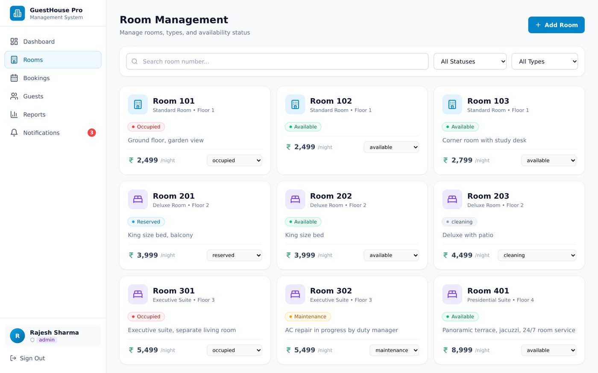
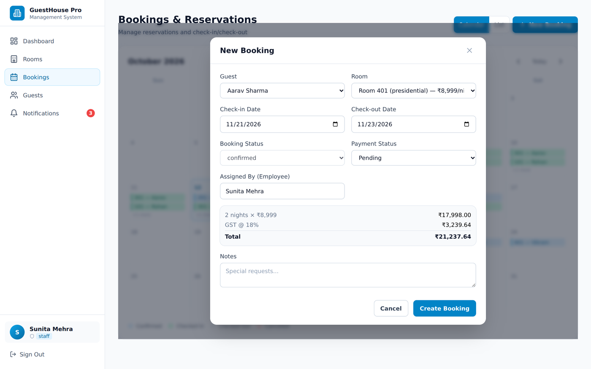
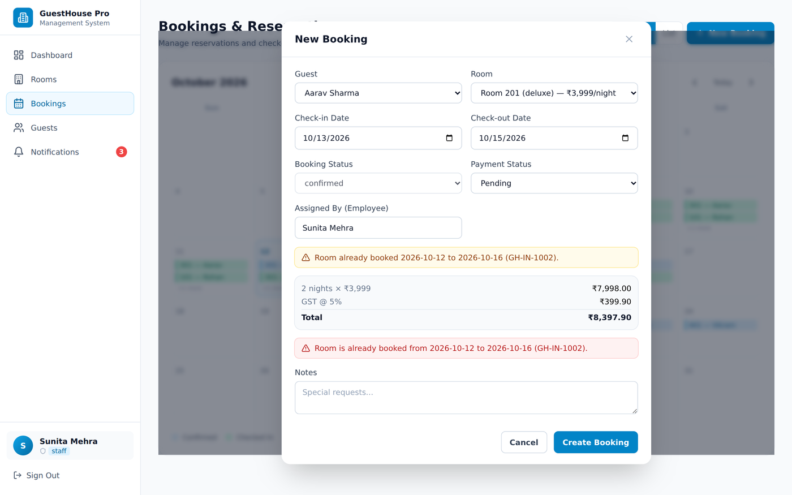
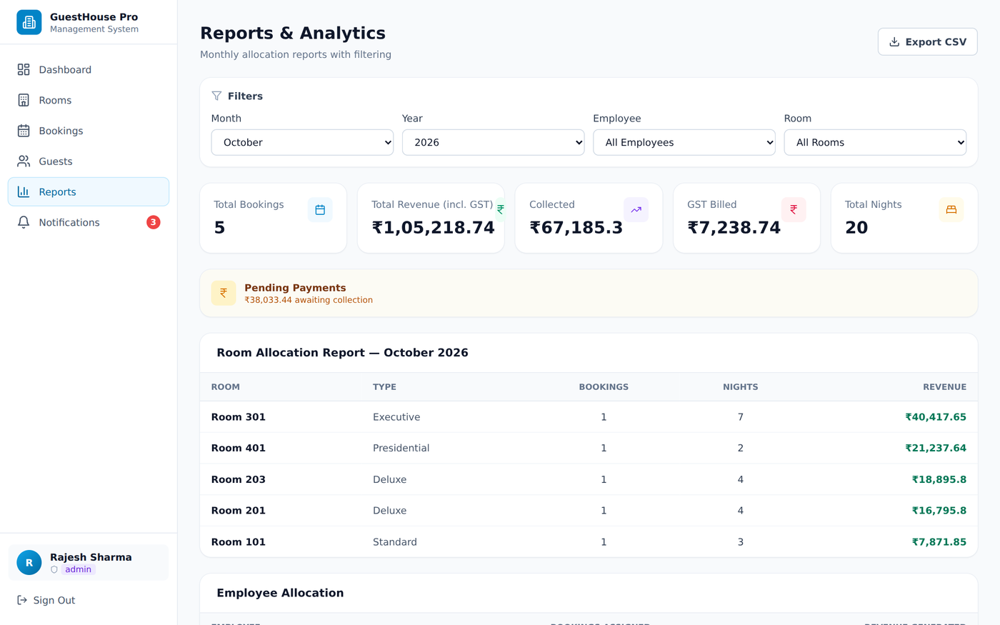

# GuestHouse Pro 🏨

> A full-featured Guest House Management System built with **React 18**, **TypeScript**, **Tailwind CSS** and **Supabase / a local offline engine**. Room-state machine, double-booking prevention, GST invoicing, Aadhaar-validated guest registry, four-layer role-based access control and 91 automated tests.

[](https://mayank-af.github.io/GUESTHOUSE/)
[](LICENSE)

- 🚀 **Live demo:** https://mayank-af.github.io/GUESTHOUSE/ (runs on the offline engine; data stays in your browser)
- 📦 **Repository:** https://github.com/MAYANK-af/GUESTHOUSE


---

## ✨ Features

### 🛏️ Rooms and the room state machine
- Four categories: **Standard, Deluxe, Executive, Presidential**, priced per night in ₹.
- Five states: `available`, `reserved`, `occupied`, `cleaning`, `maintenance`. Only legal transitions are accepted: an occupied room can never go straight to available; check-out sends it to **cleaning**, and it is released by *Mark clean*.
- Rooms under maintenance cannot be booked.



### 📅 Bookings, collision prevention and GST
- Calendar and list views; one-click check-in and check-out.
- **Double-booking is impossible:** the service layer rejects any overlapping stay for a room (same-day turnover allowed), and the database has an `EXCLUDE` constraint as a second line of defence.
- **GST by slab** (hotel rooms, per room per night): **5% up to ₹7,500, 18% above** (rates in force from 22 Sep 2025; edit the constants in `src/lib/booking.ts` if the notification changes). Subtotal, rate, GST and total are frozen on the booking and shown as an invoice.
- Live price preview and live conflict warning in the booking form.




### 👥 Guests
- Corporate guest registry with stay history.
- Identity proof: **Aadhaar (12 digits + Verhoeff checksum)**, passport, driving licence, voter ID. Numbers are masked on screen (last 4 characters only).

### 📊 Reports
- Filters by month, year, employee and room; revenue incl. GST, collected, pending, GST billed, nights; cancelled bookings excluded.
- CSV export with quote escaping and spreadsheet-formula protection.



### 🔒 Role-based access control (4 layers)
| Permission | Admin | Front-Desk Staff | Duty Manager |
|---|:-:|:-:|:-:|
| View rooms, guests, bookings, notifications | ✅ | ✅ | ✅ |
| Add / edit / delete rooms | ✅ | – | – |
| Put room in / out of maintenance | ✅ | – | ✅ |
| Mark cleaned room available | ✅ | ✅ | ✅ |
| Add / edit guests | ✅ | ✅ | – |
| Create / edit / cancel bookings | ✅ | ✅ | – |
| Check in / check out | ✅ | ✅ | ✅ |
| Delete bookings or guests | ✅ | – | – |
| Reports and CSV export | ✅ | – | ✅ |

Enforced in the UI (navigation, controls, route guard), the service layer, PostgreSQL Row-Level Security and database constraints. New production accounts are always `staff`; users cannot change their own role.

---

## 🛠️ Tech stack
React 18, TypeScript (strict), Vite, Tailwind CSS, Lucide · Supabase JS or an offline localStorage engine with the same query API · PostgreSQL (RLS, exclusion constraint) · Vitest, Testing Library, PGlite · GitHub Actions → GitHub Pages.

## 🚀 Getting started
```bash
git clone https://github.com/MAYANK-af/GUESTHOUSE.git
cd GUESTHOUSE
npm install
npm run dev        # http://localhost:5173 (offline engine by default)
```

## ✅ Quality gates
```bash
npm run lint        # ESLint
npm run typecheck   # TypeScript strict
npm test            # 91 tests: unit, service integration, database (real SQL migrations on PostgreSQL), UI
npm run build       # production bundle
```
The CI workflow runs all four before every deployment. Tests always use the offline engine, even if a local `.env` has Supabase keys.

## ⚙️ Optional Supabase connection
1. Put your credentials in `.env` (never commit it):
   ```env
   VITE_SUPABASE_URL=https://<your-project-id>.supabase.co
   VITE_SUPABASE_ANON_KEY=<your-anon-public-key>
   ```
2. In the Supabase SQL editor run, **in order**:
   - `supabase/migrations/20261011125236_create_guesthouse_schema.sql`
   - `supabase/migrations/20261012090000_v2_rbac_gst_fsm.sql`
3. Promote your first administrator in SQL: `update profiles set role = 'admin' where id = '<your-user-id>';`

## ⚠️ Known limitations
The engine (Supabase or offline) is chosen once at start-up; there is no automatic failover or offline sync. With Supabase, booking + room update + notification are separate requests (the exclusion constraint still prevents double-booking). GST ignores the CGST/SGST split, GSTIN/SAC and the input-credit condition of the 5% slab. Identity numbers are stored unencrypted. UI tests run in jsdom, not real browsers.

## 📄 License
MIT, see [LICENSE](LICENSE).
